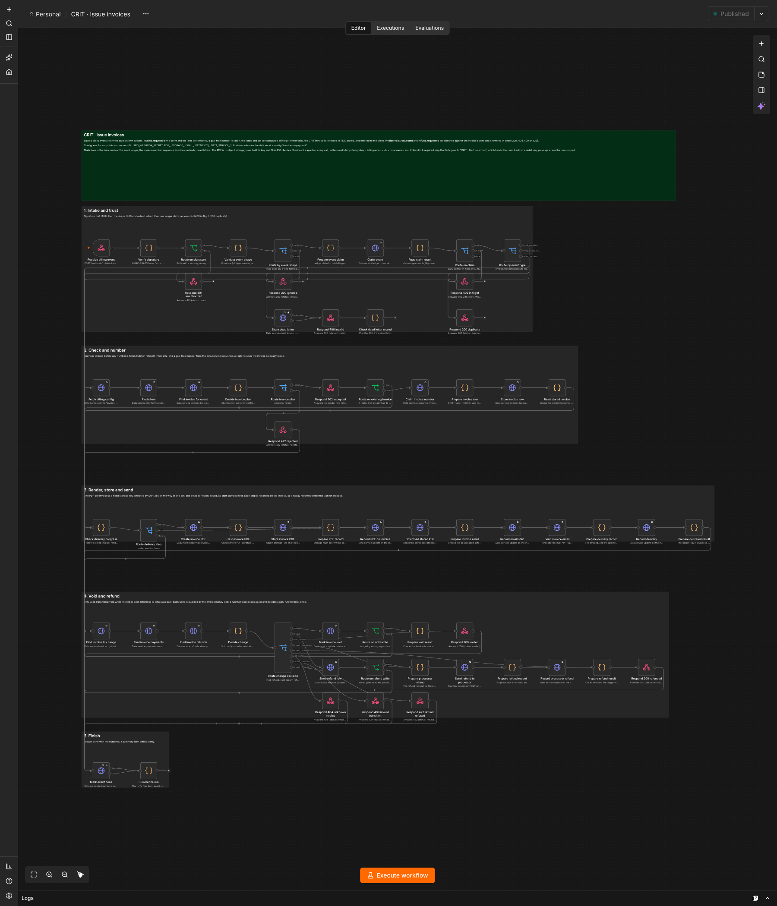

# n8n invoice to payment

An n8n build that runs a small studio's invoicing without a spreadsheet, built by CRIT ([critdept.com](https://critdept.com)). A signed request for an invoice comes in; out go a numbered invoice (gap-free sequence, totals and tax in integer minor units), a CRIT-branded PDF in object storage and an email to the client. Payments reported by the processor are matched to their invoice: a full payment gets a receipt, anything ambiguous goes to a review queue and the billing channel. Overdue invoices get reminders at 3, 10 and 21 days, and a watchdog reports invoices that never went out. For a studio or agency that bills a few dozen clients a month.

Designed and built by Christopher Pond (CRIT). 72 unit tests and 31 end-to-end scenarios, all passing on n8n 2.42.6.

| Workflow | What comes in | What goes out | Nodes | Tests passed |
| --- | --- | --- | ---: | --- |
| [CRIT · Issue invoices](invoice-to-payment/README.md) | signed `invoice.requested`, `invoice.void_requested`, `refund.requested` | a numbered invoice, its PDF in storage, the client email; voids and refunds answered 200, 404, 409 or 422 | 65 | 72/72 unit (all workflows and the kit), 31/31 end to end (all workflows) |
| [CRIT · Match payments](invoice-to-payment/README.md) | signed `payment.received` from the payment processor | a matched payment row, a receipt on full payment, review items and alerts | 42 | (same runs) |
| [CRIT · Chase overdue invoices](invoice-to-payment/README.md) | a daily and an hourly schedule, or a signed sweep request | reminder emails, one per step; a watchdog alert | 48 | (same runs) |

In their own repos:

| Workflow | Status |
| --- | --- |
| [Lead-to-booking agent](https://github.com/chrstphrpond/n8n-lead-to-booking-agent) | built |
| [UGC ad creator](https://github.com/chrstphrpond/n8n-ugc-ad-creator) | built |



The other two canvases: [Match payments](docs/match-payments-canvas.png), [Chase overdue invoices](docs/chase-invoices-canvas.png).

## Verification and test harness

- **Test data.** CRIT is the sender on the invoices; the clients, amounts and addresses in the tests are test records (every address is on the reserved `.example` domain).
- **Real n8n.** n8n 2.42.6 runs the workflows. The tests import and publish them with the n8n CLI, post HMAC-signed events to the production webhooks and check every call, row, stored object, email and alert that results.
- **No model is involved.** Every decision (totals, tax, matching, transitions, reminder steps) is plain code in `invoice-to-payment/workflow/lib/`, unit tested.
- **Test harness.** The CRIT data service (rows, ledger, invoice-number sequence, dead letters, config), the PDF renderer, object storage, the email API (Resend's request shape), the payment processor's refund call and Slack are answered by a local harness that follows their request shapes and injects failures. The PDF harness module writes the invoice's text into a valid PDF; it does not lay out the HTML template.

Verification is by the test suite described here; this repository does not include a deployment.

## What it checks

- **Duplicates.** One ledger claim per sender event id and an Idempotency-Key on every write. A redelivered invoice request answered 200 `duplicate` after one call; the same processor payment under a new event id was not recorded twice; storage failing on all 4 tries and the event redelivered still gave one number (CRIT-2026-0001, the sequence called once), one stored PDF and one email. A send whose answer was lost is resent with the same key only within 23 hours: an invoice email started 30 hours earlier, a receipt and a refund stored 30 hours earlier were not sent again, each raised an alert with ids, and an email started 2 hours earlier went out once.
- **Concurrency.** Every payment row, refund row and void is written only while the invoice's `money_seq` still has the value read before deciding; the run that loses reads again and decides again. Two events posted at the same moment, both reading before either wrote: two PHP 7,000 refunds on PHP 11,200 paid gave one processor refund and one 422; two full payments gave `exact` with one receipt and `already_paid` with a review item; PHP 4,000 and PHP 7,200 together gave `partial` and `completes` with one receipt; a void racing a payment never left a void invoice with a counted payment. The same tests on the previous build gave two processor refunds, two receipts and a failed run, no receipt, and a void invoice with a receipt.
- **Failures.** 3 retries 5 seconds apart on every call. The renderer answering 503 twice still delivered on the third try; an email API that took the send but answered after 4 s against a 1.5 s timeout was retried with the same key and one email exists; storage down for all 4 tries stopped the run, and the error workflow posted the workflow, the failed node, the error and the execution link to `#crit-alerts` and handed the claim back.
- **Money.** Integer minor units and BigInt, half-up rounding once per tax rate. PHP 130,050.50 with PHP 13,800.00 VAT, a yen invoice of JPY 57,239; a refund of PHP 12,000 against PHP 11,200 paid was refused (422), PHP 5,000 went through, and PHP 7,000 more was refused with PHP 6,200 left.
- **Guardrails.** Over-payment, wrong currency, unknown reference and payment on a void invoice each became a review item with an alert; voiding a paid invoice and refunding an unpaid one got 409. Reminders went out at 3 and 10 days and never twice; paid, refunded and void invoices got none.
- **Trust and privacy.** A wrong, missing, tampered or 10-minute-old signature got 401 with no call made; a broken payload got 400 and one dead letter, and when the dead letter could not be stored (4 tries) the sender still got 400 and `#crit-alerts` got the payload hash. Every Slack message, ledger result and review item was checked for the test clients' names, addresses and line text.

## Run it

Needs Node 24 and n8n 2.42.6 (`pnpm add -g n8n@2.42.6 --allow-build=sqlite3`). No packages to install; validation also needs n8n-mcp 2.94.3 in documentation mode (`~/.local/share/n8n-mcp`, or set `N8N_MCP_BIN`).

```sh
node _shared/bin/run-unit.mjs invoice-to-payment     # unit tests: the kit and the workflows, no n8n
node invoice-to-payment/tests/e2e.mjs                # 31 scenarios on a real n8n server (about 2 minutes once it has the e2e lock)
node _shared/bin/validate.mjs invoice-to-payment     # house-style lint and n8n-mcp validate_workflow (runtime, strict)
```

## Read more

- [`invoice-to-payment/README.md`](invoice-to-payment/README.md): architecture, test data, scenarios, limits.
- [`invoice-to-payment/SPEC.md`](invoice-to-payment/SPEC.md): events, flow by section, tables, config.
- [`invoice-to-payment/VALIDATION.md`](invoice-to-payment/VALIDATION.md): every check and its result.
- [`invoice-to-payment/BUILD-LOG.md`](invoice-to-payment/BUILD-LOG.md): what came up during the build.
- [`_shared/KIT.md`](_shared/KIT.md): the shared CRIT kit (builder, stand-ins, harness, error workflow), vendored unchanged.

## License

MIT, see [LICENSE](LICENSE).
