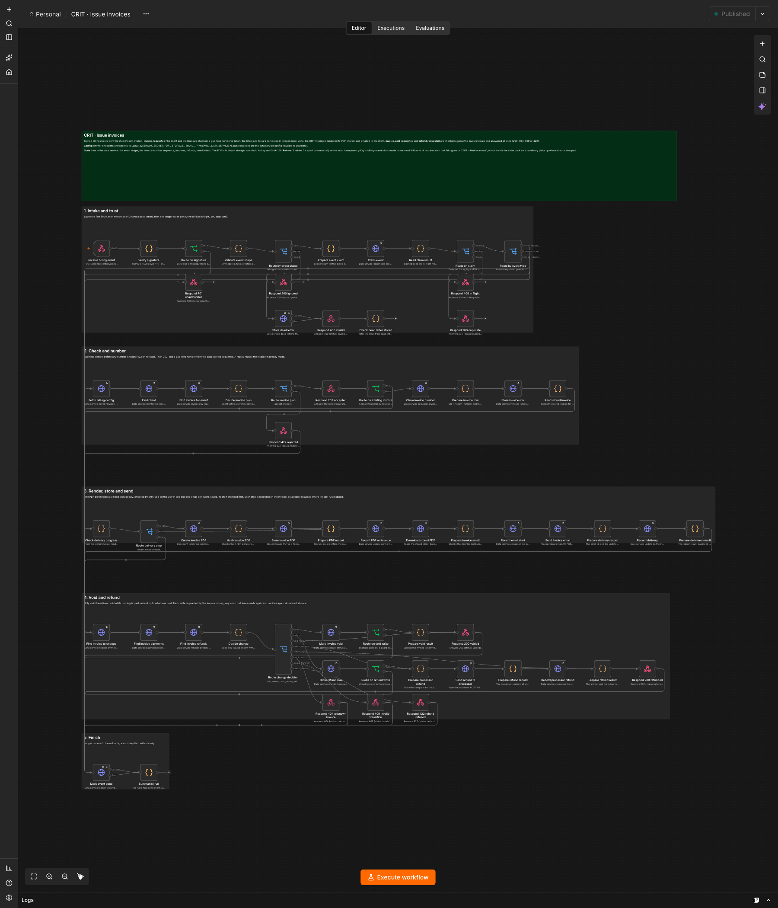

# CRIT invoicing: invoice to payment in n8n

A small studio (CRIT, the sender on every invoice) asks for an invoice with a signed event. The invoice is checked, numbered from a gap-free sequence, totalled in integer minor units, rendered from a CRIT HTML template to PDF, stored, and emailed to the client. When the payment processor reports a payment, it is matched to the invoice by its reference; a full payment gets a receipt, and anything ambiguous (over-payment, wrong currency, unknown reference, payment on a void invoice) goes to a review queue and the billing channel. A daily sweep sends reminders at 3, 10 and 21 days late, and an hourly watchdog reports invoices that were numbered but never delivered. Voids and refunds are allowed only where the invoice's state permits.

**Test data and harness.** The clients, amounts and addresses in the tests are test records. The data service, the PDF renderer, object storage, the email API, the payment processor and Slack are answered by a **local test harness** that follows the real APIs' request shapes. Verification is by the test suite described here; this repository does not include a deployment. See [Scope and limits](#scope-and-limits).



## Run it

Needs Node 24 and the global n8n 2.42.6 (`pnpm add -g n8n@2.42.6 --allow-build=sqlite3`); validation also needs n8n-mcp 2.94.3 in documentation mode (`~/.local/share/n8n-mcp`, or set `N8N_MCP_BIN`). From the repository root:

```sh
node _shared/bin/run-unit.mjs invoice-to-payment            # 72 unit tests (30 kit + 42 workflow), no n8n
node invoice-to-payment/tests/e2e.mjs                       # 31 scenarios on a real n8n server (about 2 minutes once it has the e2e lock)
node invoice-to-payment/tests/e2e.mjs --only payment_over,watchdog   # a subset
node _shared/bin/validate.mjs invoice-to-payment            # house-style lint + n8n-mcp validate_workflow (runtime, strict)
node invoice-to-payment/workflow/build.mjs                  # rebuild the JSON and layout.json (--check: fail if stale)
```

The e2e run takes the machine-wide test lock, makes a fresh temporary n8n folder, imports and publishes the three workflows and the shared error workflow with the n8n CLI, starts `n8n start` on free ports bound to 127.0.0.1 with an allowlisted environment, and posts HMAC-signed events to the production webhooks. Each scenario asserts the HTTP answer, the calls made in order, the rows and ledger entries, the stored PDF, the emails and the alerts. Everything is stopped and deleted at the end, also on failure. Results land in [`results/`](results/), with the per-user temp folder written as `<tmp>`; see [VALIDATION.md](VALIDATION.md).

To look at it in the editor: `( . ./env.sh && node standins/serve.mjs )` in one terminal, then `./import.sh` and `./start.sh` in this folder (data folder `~/.n8n-crit-invoice-to-payment`, port 5699). `node scripts/capture-canvas.mjs` makes the canvas screenshots in `docs/` from a throwaway editor instead.

## Test data

| | Real | Placeholder |
| --- | --- | --- |
| Clients | the shape: id, name, email, billing currency, status | the names (Harbor & Pine Coffee, Lumen Dental Studio, Kiso Ramen Bar, Old Mill Studio) and every address, on the reserved `.example` domain |
| Money | PHP and USD with 2 decimals, JPY with none; VAT 12%, a 10% consumption tax, zero-rated lines | every amount and line |
| Seller | CRIT, critdept.com, billing@critdept.com | the street address and the tax id on the invoice (marked placeholder in config) |
| Events | the signature scheme and envelope defined in SPEC.md | every event id, payment id and processor refund id (`*_test_*`) |
| PDF | the bytes are a valid one-page PDF with the invoice's text | the layout: the harness renderer writes the text lines, it does not lay out the HTML |

## Architecture

```
 billing system ──signed──> POST /webhook/crit/invoices/billing-events     (CRIT · Issue invoices, 65 nodes)
   [1] HMAC + timestamp --401   shape --400 + dead letter (not stored -> alert)   other type --200 ignored
       ledger claim on event id --in_flight--> 409 Retry-After   --done--> 200 duplicate
   invoice.requested
   [2] config, client, invoice already made for this event?   checks --422 rejected (no number taken)
       --> 202 accepted --> sequence invoice-<year>: same event, same number --> invoice row (issued)
   [3] render HTML -> PDF (%PDF, size, SHA-256) -> PUT invoices/<year>/<number>.pdf -> record hash on invoice
       -> read the object back, check hash -> stamp email_started_at -> email with PDF (keyed) -> issued -> sent
   invoice.void_requested / refund.requested
   [4] invoice (money_seq), its payments and refunds -> void (nothing paid) | refund (<= paid - refunded)
       guarded write: money_seq unchanged? --no--> read again, decide again   --yes--> processor (keyed)
       404 unknown | 409 invalid transition | 422 refund refused | 200 voided / refunded
   [5] ledger done, summary

 payment processor ──signed──> POST /webhook/crit/invoices/payment-events  (CRIT · Match payments, 42 nodes)
   [1] same intake --> 202
   [2] invoice by reference (money_seq) + payments and refunds before this one -> one decision
       -> guarded payment row: money_seq unchanged? --no--> read again, decide again
   [3] full payment --> receipt (keyed) -> receipt id on the invoice
   [4] ambiguous --> review item + #crit-billing (ids and amounts only)
   [5] ledger done, summary

 09:00 daily / hourly :20 / signed sweep request ──> CRIT · Chase overdue invoices (48 nodes)
   [1] clock fixed once (as_of only if INVOICE_CLOCK_OVERRIDE=allow)
   [2] sent + past due? --no--> stop   step reached and not sent? --no--> stop
       ledger claim per invoice and step -> email (keyed) -> reminders row -> done   (taken-over claim -> review)
   [3] issued for 30+ min, or number without invoice --> claim once -> one alert to #crit-billing

 a required step fails after 3 retries --> CRIT · Alert on errors: the run's claims handed back, alert to #crit-alerts
```

155 nodes in three workflows, generated by [`workflow/build.mjs`](workflow/build.mjs) from `workflow/flows/*.mjs`. The logic is in plain modules in `workflow/lib/` (dates, money, signatures, event shapes, invoices, documents, payments, transitions, reminders and watchdog), unit tested and inlined into the Code nodes. [`workflow/layout.json`](workflow/layout.json) lists every node with its section, canvas position and note, and every connection, for drawing the workflows elsewhere.

### Design decisions

- **One endpoint per sender, signed over the raw bytes.** The studio's system and the payment processor each have their own path and secret. The HMAC covers `"<t>.<raw body>"`, the JSON is parsed from the verified bytes, and an authentic request older than 300 seconds is refused as a replay.
- **A number only after every check.** Client, currency, dates, tax codes and totals are checked before the sequence is touched, so a refused request (422) leaves no gap. The sequence returns the same value for the same event id, so a retry or a replay never takes a second number. The watchdog reports a number that was taken but never got its invoice.
- **Resume, do not repeat.** Each delivery step is recorded on the invoice (`pdf_sha256`, `email_started_at`, then `email_id` and `sent`). A replay after a failure reads the invoice and goes on from the first step not recorded; a payment or refund row already stored by the event is not written again, the run goes on from it. The PDF has one storage key per invoice; the email and the processor refund carry an Idempotency-Key per event, so a retry after a timeout gets the first answer.
- **Money from rows, never a running total.** Paid and refunded amounts are summed from the payment and refund rows. A payment is decided against the payments recorded before it and the decision is stored with it; a replay reads it back.
- **One money write at a time per invoice.** Each invoice has a counter, `money_seq`. A payment row, a refund row or a void is written only while the counter still has the value read before deciding, and the counter moves on in the same step (one Postgres statement, in SPEC.md). The run that loses gets `outcome: conflict` (a 200, so n8n does not retry the stale request), reads the invoice and its rows again and decides again; the processor is called only after the refund row won. A conflict means another write won, so the loop ends; a run stops after 5 passes in a row.
- **No resend after the key window.** The email API and the processor keep an Idempotency-Key for 24 hours. A replay that cannot know whether a send went out (an invoice email stamped as started, a receipt or refund whose row exists without a recorded answer) resends with the same key only within 23 hours of the stamp or the row; after that the run stops with the ids and a person checks the provider.
- **Ambiguity goes to a person.** Over-payment, payment on a paid or void invoice, wrong currency, unknown reference, payment after a refund, and a reminder whose run died all become review items with an alert. None of them is guessed.
- **Ids and amounts in every alert, ledger result and summary.** Client names, email addresses and line-item text stay in the data service and the emails to the client. The e2e run checks every Slack message, ledger result and review item for the test clients' names, addresses and line descriptions. Successful runs keep no execution data (`saveDataSuccessExecution: none`).
- **The clock is a parameter.** The sweeps read the time once; tests fix it with `as_of`, which is ignored unless `INVOICE_CLOCK_OVERRIDE=allow`.

### Configuration

| Variable | Purpose |
| --- | --- |
| `BILLING_WEBHOOK_SECRET`, `PAYMENTS_WEBHOOK_SECRET` | HMAC secrets of the two senders (the sweep requests use the billing one) |
| `PDF_BASE_URL`, `PDF_API_TOKEN` | the document rendering service |
| `STORAGE_BASE_URL`, `STORAGE_TOKEN`, `STORAGE_BUCKET` | object storage for the PDFs |
| `EMAIL_BASE_URL`, `EMAIL_API_KEY`, `EMAIL_FROM`, `EMAIL_TIMEOUT_MS` | the transactional email API (Resend's request shape) |
| `PAYMENTS_BASE_URL`, `PAYMENTS_API_KEY` | the payment processor's refund call |
| `REVIEW_SLACK_CHANNEL` | the billing review channel (same Slack bot as the alerts) |
| `INVOICE_CLOCK_OVERRIDE`, `INVOICE_SCHEDULES` | `allow` lets a sweep request fix the clock (tests only); `off` stops the scheduled runs |
| `DATA_SERVICE_*`, `ALERTS_SLACK_*`, `N8N_EDITOR_BASE_URL` | the kit's data service and the shared error workflow |

Business rules (seller, currencies, tax rates, number format, reminder steps, watchdog threshold) are the data service config `invoice-to-payment`, shown in [SPEC.md](SPEC.md) with the table shapes. No `.env` files: `env.sh` holds placeholders for the local stand-ins only, and the tests generate random secrets per run.

## Scenarios

What each run observed is in [VALIDATION.md](VALIDATION.md#observed-outcomes).

| Scenario | What happens |
| --- | --- |
| `happy_create_deliver` | numbered CRIT-2026-0001, PHP 130,050.50 with PHP 13,800.00 VAT, PDF stored, emailed with the PDF |
| `gap_free_numbers` | good, refused (422), good: 0001 and 0002; a yen invoice with zero decimals |
| `redelivered_event`, `redelivery_while_in_flight` | 200 duplicate after one call; 409 Retry-After during the run |
| `bad_signature`, `stale_timestamp`, `invalid_payload` | 401 with no call; 400 with one dead letter; n8n's own 422 for a body that is not JSON |
| `pdf_5xx_retry`, `email_timeout_after_send` | 503 twice then delivered; a timed-out send retried with the same key, one email |
| `storage_failure_error_workflow` | storage down for 4 tries: alert with node, error and link, claim released; the redelivery keeps the same number and delivers once |
| `payment_exact`, `payment_partial_then_rest`, `payment_over` | receipt; no receipt then receipt; receipt plus review for the excess |
| `payment_wrong_currency`, `payment_unknown_reference`, `payment_on_void_invoice` | not counted, review and alert |
| `payment_duplicates` | redelivered payment event; same processor payment under a new event id |
| `refund_limits`, `invalid_transitions` | 422 above what was paid; 409 for a paid void, an unpaid refund, a second void; 404 unknown |
| `reminder_steps`, `reminder_skips`, `reminder_early_exit`, `reminder_after_failed_run` | 3 then 10 days, never twice; paid, refunded and void skipped; two calls when nothing is overdue; review instead of a resend |
| `watchdog` | stuck invoice and orphan number reported once |
| `invoice_to_payment_chain` | requested, emailed, paid, receipt, and left alone by the sweep |
| `concurrent_refunds` | two PHP 7,000 refunds posted together on PHP 11,200 paid: one refunded (one processor call), one 422 with PHP 4,200 left |
| `concurrent_full_payments`, `concurrent_partial_and_rest` | two full payments together: `exact` with one receipt, `already_paid` with a review; PHP 4,000 and PHP 7,200 together: `partial`, then `completes` with one receipt |
| `concurrent_void_and_payment` | a void and a full payment together: the payment landed first (exact, receipt), the void was decided again and got 409 |
| `dead_letter_store_failure` | the dead letter refused 4 times: 400 to the sender, alert with the payload hash |
| `late_redelivery_after_lost_answer` | an email started 30 h earlier, a receipt and a refund stored 30 h earlier: not resent, three alerts; an email started 2 h earlier: resent with the same key, delivered once |

## Scope and limits

- **Harness, not vendor services.** The tests used no live data service, renderer, storage, email account, payment processor or Slack workspace. Real object storage (S3 or R2) signs requests with SigV4, which a bearer token does not cover; the storage nodes would change for those. A real processor refunds a specific charge, not "the payer of reference X"; the refund call would map to the charge id.
- **The PDF harness module does not lay out the HTML.** It returns a valid PDF with the document's text lines, so the bytes, hash and attachment are tested, not the look of the template.
- **The schedules were not run.** In the e2e run `INVOICE_SCHEDULES=off`, and the sweeps were started by signed requests. The Schedule Trigger settings are checked by a unit test only.
- **Concurrency was tested against the stand-in, not Postgres.** The races ran on real n8n with real parallel requests (a slowed read made both runs read before either wrote), but the data service is in memory and handles one request at a time, so each guarded write is atomic there by construction. The Postgres statements that give the same guarantee are in SPEC.md and were not run. In `concurrent_void_and_payment` the payment landed first in the recorded run; the void-first order is covered by a unit test against the stand-in.
- **A void racing a delivery in flight** is not guarded by `money_seq` (delivery moves no money): the delivery's last update (`issued -> sent`) fails into the error workflow after the email went out, and the alert says so.
- **Late resends are refused, not resolved.** A replay past the 23-hour window fails into the error workflow with the ids (each further redelivery alerts again) until a person records the answer or voids the invoice. The window is 23 hours, not 24, and for receipts and refunds it counts from the row's `created_at`, which is never later than the send; so some replays are refused although a resend would still have been deduplicated.
- **A run that loses the guard 5 times in a row stops** into the error workflow. For a payment the processor already has its 202, so the alert is what brings it back.
- **Reads are whole tables in the sweeps.** Payments, refunds, reminders and clients are read in full per sweep. Fine for a studio's volume; a larger book needs filtered queries.
- **Failed runs keep their execution data** in n8n (client email and PDF included) for debugging, for the pruning window (`EXECUTIONS_DATA_MAX_AGE`, 168 hours).

## Files

| Path | What it is |
| --- | --- |
| `workflow/build.mjs`, `workflow/flows/*.mjs` | build the three workflow files, `manifest.json` and `layout.json` (`--check` fails if stale) |
| `workflow/lib/*.js` | the logic, inlined into Code nodes |
| `standins/` | the data service extension, the four vendor stand-ins, the set for tests (`index.mjs`) and for the local editor (`serve.mjs`) |
| `fixtures/config.json`, `fixtures/clients.json` | the config document and the test clients |
| `tests/unit.test.mjs`, `tests/run-code.mjs`, `tests/e2e.mjs` | unit tests, the multi-item Code-node runner (with `$runIndex`), the real-n8n run |
| `scripts/capture-canvas.mjs` | the canvas screenshots in `docs/` |
| `env.sh`, `start.sh`, `import.sh`, `export.sh` | the local editor |
| `results/` | the last run's evidence |
| `SPEC.md`, `VALIDATION.md`, `BUILD-LOG.md` | design, what was run and observed, what came up during the build |
